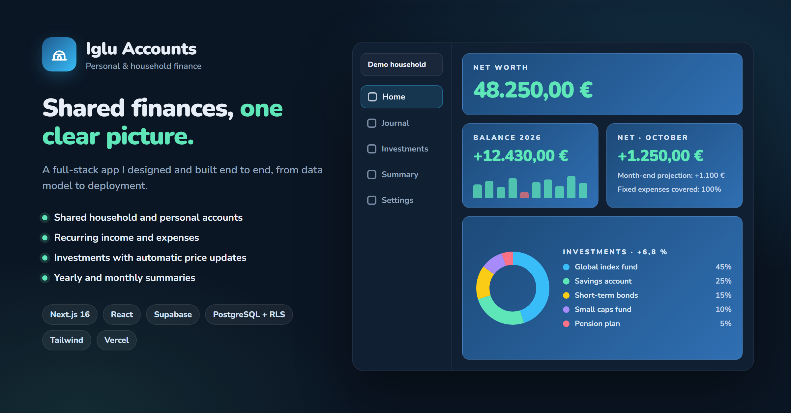

# Iglú — household finance app

A mobile-first Progressive Web App to track a household's money: daily income and expenses, shared accounts, recurring bills, an investment portfolio that prices itself, and yearly summaries. Built and used daily by two people, so the focus is on fast entry, clear figures and zero running cost.

**Stack:** Next.js 16 (App Router, Server Actions) · React 19 · TypeScript · Supabase (Postgres, Auth, RLS) · Tailwind CSS 4 · Zod 4 · Vitest · Playwright · Vercel



*Illustrative preview with made-up figures; no real account data.*

## Features

**Daily movements**
- Add an expense, income, debt or bank↔cash transfer in a few taps: large amount field (it also accepts sums such as `12,50+8`), one-tap date chips, the most used categories as chips, and frequent concepts that fill the category for you.
- Duplicate detection before saving, quick "save and add another", and category suggestions from past entries.
- Daily journal grouped by day with sticky day totals, search by concept *or* amount, category filter, and a per-category breakdown.
- Touch gestures: swipe to delete (with undo) or duplicate, long-press to multi-select and re-categorise or delete in bulk.

**Shared accounts**
- Several accounts per user (e.g. a household account and a personal one), switched in place.
- Row Level Security in Postgres: every query is scoped to the accounts the user belongs to.

**Recurring movements**
- Monthly, last-day, last-weekday and bimonthly schedules, created automatically by a daily cron, with optional web-push notifications and a weekly summary.

**Investments**
- Funds, ETFs and stocks with contributions, units and purchase price.
- Prices update automatically every hour: fund NAVs by ISIN and market quotes (pre/post-market included) by ticker, converted to EUR.
- Each position shows when its price last changed and flags stale ones; positions can be checked against the price source before saving.
- Portfolio distribution chart, sortable positions table and a monthly return history.

**Summaries**
- Month and year cards (income, expenses, net), a category × month grid, a category ranking and year-over-year comparison.

**App quality**
- Installable PWA with offline banner, passkey (fingerprint) login, light/dark themes and a "hide amounts" mode.
- Strict security headers (Content Security Policy, frame and referrer policies) and server-side validation with Zod on every action.

## Architecture

```
src/
├─ app/                 Next.js App Router
│  ├─ (auth)/           login (password or passkey)
│  ├─ (app)/            dashboard, expenses, summary, investments, recurring, settings, import
│  └─ api/cron/         scheduled jobs: recurring movements, prices, monthly returns
├─ actions/             Server Actions — the only write path, each one authenticated and validated
├─ components/          UI, grouped by feature (expenses, investments, dashboard, summary, layout, ui)
├─ lib/
│  ├─ db/               repository layer: one interface, a Supabase provider behind it
│  ├─ validators/       Zod schemas shared by forms and actions
│  └─ …                 pure helpers (formatting, dates, aggregations, price fetching)
└─ tests/               Vitest unit and component tests
supabase/
├─ migrations/          additive SQL migrations, applied in order
└─ cron/                pg_cron job that calls the hourly price update
e2e/                    Playwright specs (read-only against a real session)
```

- **Server-first:** pages are Server Components that read through the repository layer; mutations go through Server Actions and revalidate the affected routes.
- **Repository pattern:** components and actions depend on `lib/db`, not on Supabase directly, which keeps data access testable and swappable.
- **Large tables:** totals are read with paginated range queries so they stay correct past Supabase's 1,000-row response limit.
- **Scheduled work:** Vercel Cron runs the daily jobs; Supabase `pg_cron` + `pg_net` call the price update hourly within a Europe/Madrid time window.
- **Testing:** 240+ Vitest tests (logic, components, actions with a mocked Supabase client) run in CI together with lint, type-checking and a production dependency audit.

## Running locally

**Requirements:** Node.js 22 or 24, and a free [Supabase](https://supabase.com) project.

1. **Install**
   ```bash
   npm install
   ```
2. **Configure** — copy `.env.example` to `.env.local` and fill it with your Supabase project's values (Project Settings → API). The service-role key, cron secret and VAPID keys are only needed for the scheduled jobs and push notifications.
3. **Create the database** — in the Supabase SQL Editor, run every file in `supabase/migrations/` in numeric order.
4. **Create users** — there is no public sign-up: add users under Authentication → Users ("Auto Confirm User").
5. **Start**
   ```bash
   npm run dev        # http://localhost:3002
   ```

A step-by-step guide (in Spanish) covering Supabase, Vercel and migrations is in [`docs/SETUP.md`](docs/SETUP.md).

### Scripts

| Command | What it does |
| --- | --- |
| `npm run dev` | Development server on port 3002 |
| `npm run build` | Production build |
| `npm run lint` | ESLint |
| `npm run typecheck` | TypeScript, no emit |
| `npm run test:ci` | Vitest, single run |
| `npm run e2e` | Playwright end-to-end tests (needs `npm run e2e:login` first) |

## License

[MIT](LICENSE) © 2026 Alberto Jesús Rodríguez Pulido
